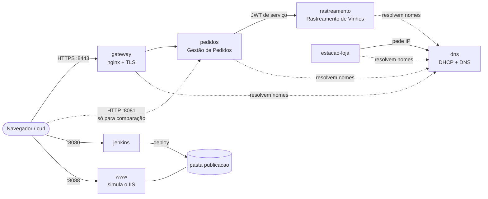

# Vinheria Agnello · Infraestrutura e deploy dos microsserviços

Ambiente completo, em contêineres Docker, com dois microsserviços da Vinheria Agnello: uma rede própria com **DHCP e DNS**, **deploy automático com Jenkins** e **comunicação segura** (login com JWT e HTTPS).

## Sobre o projeto

A **Vinheria Agnello** é uma loja de vinhos que organiza seus sistemas em **microsserviços**: pequenos programas independentes, cada um cuidando de uma parte do negócio. Este projeto monta, em um único computador, uma versão em miniatura dessa estrutura com dois deles:

- **Rastreamento de Vinhos:** sabe quais lotes existem, a situação de cada um (disponível, em fermentação ou bloqueado) e quantas garrafas há.
- **Gestão de Pedidos:** é onde o vendedor faz login e registra uma venda. Antes de vender, ele pergunta ao Rastreamento se aquele lote pode ser vendido.

Em volta desses dois serviços, o projeto reproduz o que uma empresa tem no dia a dia:

| Parte | O que acontece |
|---|---|
| **Rede** | Um servidor entrega endereço automaticamente para cada máquina (**DHCP**) e traduz nomes como `pedidos.vinheria.local` em endereços (**DNS**). Assim os serviços se encontram pelo nome. |
| **Deploy automático** | O **Jenkins** pega o código deste repositório, testa, confere se não há senhas no código e publica a nova versão sozinho. |
| **Segurança** | Só entra quem faz login (token **JWT**), os serviços se identificam entre si e o acesso é criptografado (**HTTPS**). Uma captura no **Wireshark** mostra a diferença: por HTTP a senha aparece; por HTTPS, não. |

---

## Arquitetura



<details>
<summary><b>Contêineres, nomes e IPs</b></summary>

| Contêiner | Nome no DNS | IP | Função |
|---|---|---|---|
| `vinheria-dns` | dns.vinheria.local | 172.28.0.2 | Servidor **DNS + DHCP** (dnsmasq) |
| `vinheria-rastreamento` | rastreamento.vinheria.local | 172.28.0.10 | Microsserviço **Rastreamento de Vinhos** (só rede interna) |
| `vinheria-pedidos` | pedidos.vinheria.local | 172.28.0.11 | Microsserviço **Gestão de Pedidos** (login JWT) |
| `vinheria-www` | www.vinheria.local | 172.28.0.12 | Servidor de **publicação** (simula o IIS) |
| `vinheria-gateway` | gateway.vinheria.local | 172.28.0.13 | **HTTPS (TLS)** na frente do Pedidos |
| `vinheria-jenkins` | jenkins.vinheria.local | 172.28.0.14 | **Jenkins** (pipeline de deploy) |
| `vinheria-estacao` | estacao-loja.vinheria.local | DHCP (.100 a .150) | Estação da loja que recebe IP por **DHCP** |

</details>

**Tecnologias:** Docker Compose · Python 3.12 + Flask · PyJWT · dnsmasq · nginx · Jenkins · Wireshark

---

## Pré-requisitos

- Windows 10/11 com **Docker Desktop** instalado e aberto (ícone da baleia "Engine running").
- **Git**.
- Portas livres: **8080, 8081, 8088 e 8443**.
- Opcional: **Wireshark** (com Npcap) para a comparação HTTP x HTTPS.

---

## Como rodar

Abra o **PowerShell** e execute:

**1. Baixe o projeto**
```powershell
git clone https://github.com/alefaria577/vinheria-agnello-infra.git
cd vinheria-agnello-infra
```

**2. Crie o arquivo de configuração**
```powershell
copy .env.example .env
notepad .env
```
Troque os dois valores e salve:

| Variável | Para que serve |
|---|---|
| `JWT_SEGREDO` | Chave que assina os tokens (use 32 caracteres ou mais) |
| `JENKINS_ADMIN_SENHA` | Senha do usuário `admin` do Jenkins |

> O `.env` fica só na sua máquina e não vai para o Git.

**3. Suba o ambiente**
```powershell
docker compose up -d --build
```
Na primeira vez leva alguns minutos (download das imagens). Confira com `docker compose ps`: os contêineres devem aparecer como **Up**. O Jenkins leva cerca de 1 minuto para abrir.

> O Jenkins já vem pronto dentro do Docker (com os plugins e o usuário `admin`), sem precisar instalar o `jenkins.war`. Se houver outro Jenkins aberto no computador usando a porta 8080, feche a janela dele antes deste passo.

**4. Valide tudo de uma vez**
```powershell
powershell -ExecutionPolicy Bypass -File demo\validar.ps1
```
O script confere contêineres, DHCP, DNS, comunicação entre serviços, JWT, HTTPS, Jenkins e os testes automáticos.
Resultado esperado: **`=== Resultado: 24 OK, 0 falha(s) ===`**

### Endereços

| O quê | Endereço |
|---|---|
| Jenkins | http://localhost:8080 (usuário `admin`, senha do `.env`) |
| Página publicada pelo deploy | http://localhost:8088 |
| API Pedidos por HTTPS | https://localhost:8443/health (certificado de laboratório: aceite o aviso) |
| API Pedidos por HTTP (só para a comparação no Wireshark) | http://localhost:8081/health |

---

## DHCP e DNS

```powershell
docker logs vinheria-estacao                                  # IP, gateway e DNS recebidos por DHCP
docker exec vinheria-estacao nslookup pedidos.vinheria.local  # nome do serviço -> IP
docker logs vinheria-dns                                      # consultas DNS e pedidos DHCP registrados
```

---

## Usando a API

Usuários de exemplo: `vendedor` / `Vinho@2026` e `gerente` / `Agnello@2026`.

```powershell
# 1. Login (devolve um token JWT válido por 30 minutos)
$token = (curl.exe -s -k -X POST https://localhost:8443/auth/login -H "Content-Type: application/json" --data "@demo/login.json" | ConvertFrom-Json).token

# 2. Registrar uma venda (o Pedidos consulta o Rastreamento antes)
curl.exe -k -X POST https://localhost:8443/pedidos -H "Authorization: Bearer $token" -H "Content-Type: application/json" --data "@demo/pedido.json"
```

Resposta esperada: **201** (venda registrada). Na pasta `demo/` também há exemplos de lote bloqueado (`pedido-bloqueado.json` → **409**) e senha errada (`login-errado.json` → **401**).

### No Postman ou Insomnia

1. Desligue a verificação do certificado, que é de laboratório:
   - **Postman:** *Settings* → *General* → **SSL certificate verification** desligado.
   - **Insomnia:** *Preferences* → *General* → desmarque **Validate certificates**.
2. **Login:** `POST https://localhost:8443/auth/login`, com *Body* → *raw* → *JSON*:
   ```json
   {"usuario": "vendedor", "senha": "Vinho@2026"}
   ```
   Copie o valor de `token` da resposta.
3. **Venda:** `POST https://localhost:8443/pedidos`, aba **Authorization** → **Bearer Token** → cole o token, e *Body* → *raw* → *JSON*:
   ```json
   {"lote": "L2024-01", "quantidade": 6}
   ```
   Resposta: **201**. Com `"lote": "L2023-07"` (bloqueado pela qualidade), a resposta é **409**.

O **Rastreamento** não tem porta aberta para fora: só o Pedidos chega nele, com um token de serviço que vale 2 minutos.

---

## Pipeline no Jenkins

1. Acesse http://localhost:8080 e entre com `admin` e a senha do `.env`.
2. **Nova tarefa** (*New Item*) → nome `vinheria-deploy` → **Pipeline** → **OK**.
3. Em **Pipeline**, escolha **Pipeline script from SCM** e preencha:
   - **SCM:** Git
   - **Repository URL:** `https://github.com/alefaria577/vinheria-agnello-infra.git`
   - **Branch:** `*/main`
   - **Script Path:** `Jenkinsfile`
4. **Salvar** (*Save*) → **Construir agora** (*Build Now*).

Etapas: **Checkout → Build** (`echo "Deploy da Vinheria"`) **→ Testes → Segurança → Deploy**. Ao terminar, http://localhost:8088 mostra o número do build, o commit e a data do deploy.

---

## HTTP x HTTPS no Wireshark

1. Abra o Wireshark e escolha o adaptador **Adapter for loopback traffic capture**.
2. Filtro `tcp.port == 8081` e faça o login por HTTP:
   ```powershell
   curl.exe -X POST http://localhost:8081/auth/login -H "Content-Type: application/json" --data "@demo/login.json"
   ```
   ➜ usuário, senha e token aparecem em texto puro.
3. Filtro `tcp.port == 8443` e faça o mesmo login por HTTPS (comando do passo 1 de "Usando a API").
   ➜ aparece o handshake **TLS 1.3** e só *Application Data* criptografado.

**Medidas de segurança aplicadas:** senhas guardadas com hash · tokens com prazo curto e destino definido (`aud`) · Rastreamento sem porta exposta · HTTPS com TLS 1.2/1.3 e HSTS · segredos só no `.env` · contêineres sem usuário root · pipeline que bloqueia segredos no código.

---

## Testes automáticos

Já rodam no `validar.ps1` e no pipeline. Para rodar sozinho, sem instalar Python:
```powershell
docker run --rm -v "${PWD}:/app" -w /app python:3.12-slim sh -c "pip install -q flask==3.0.3 pyjwt==2.9.0 requests==2.32.3 && python -m unittest discover -s testes -v"
```

---

## Estrutura

```
servicos/        rastreamento/ e pedidos/ (código + Dockerfile de cada serviço)
infra/           dns/ (DHCP + DNS), estacao/, gateway/ (HTTPS), jenkins/, web/ (modelo da página)
testes/          11 testes automáticos
demo/            exemplos de requisição e validar.ps1
publicacao/      pasta de publicação (simula o IIS)
Jenkinsfile      pipeline de deploy
docker-compose.yml
```

---

## Parar o ambiente

```powershell
docker compose down        # para tudo
docker compose down -v     # para tudo e apaga os dados do Jenkins (começa do zero)
```

## Observações

| Sintoma | Solução |
|---|---|
| `Defina JWT_SEGREDO no arquivo .env` | O `.env` não foi criado: refaça o passo 2 |
| `error during connect` / Docker não responde | Abra o Docker Desktop e espere "Engine running" |
| `port is already allocated` ou `Ports are not available` | Outro programa usa a porta 8080, 8081, 8088 ou 8443 (por exemplo, um Jenkins iniciado pelo `jenkins.war`): feche-o e rode `docker compose up -d` de novo |
| Jenkins não abre | Aguarde cerca de 1 minuto após subir e atualize a página |
| Aviso de certificado no navegador | Esperado: o certificado é de laboratório. Clique em *Avançado* → *Continuar* |
